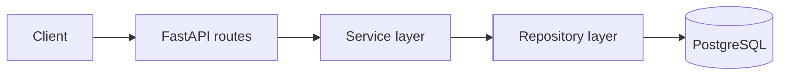
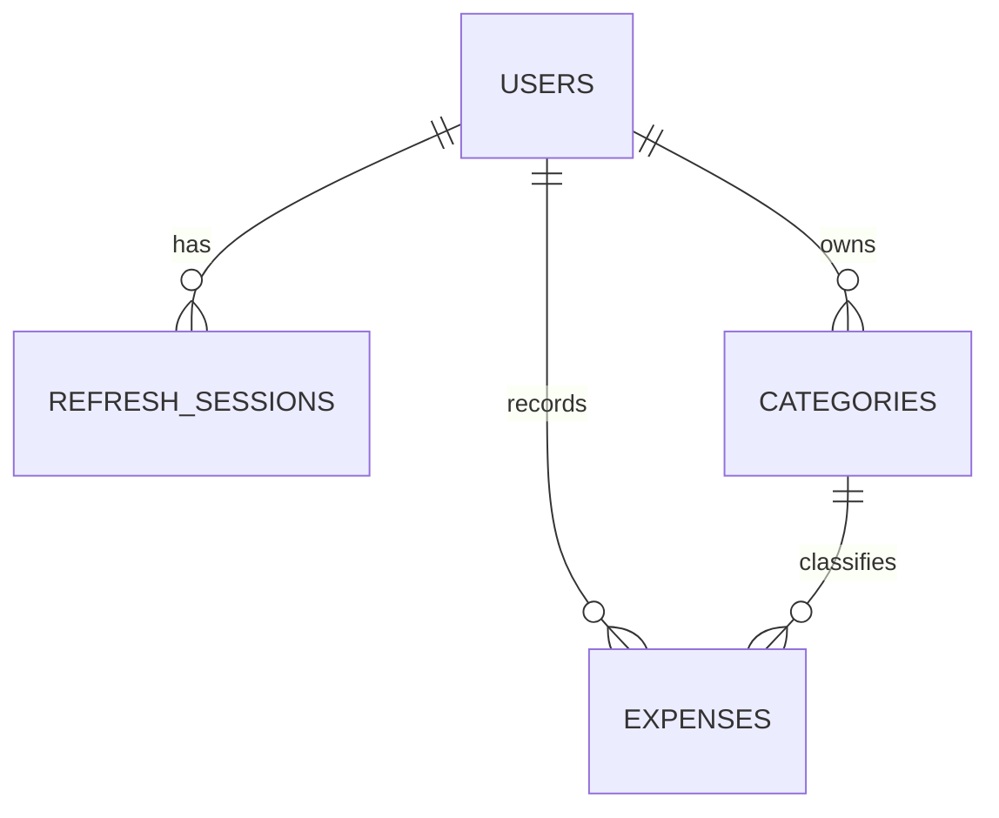

# Kế hoạch triển khai FinSight AI

Mục tiêu trước mắt là hoàn thành một backend MVP bằng FastAPI và PostgreSQL. OCR, Redis và AI chỉ làm sau khi MVP chạy ổn định và có test.

## 1 Phạm vi MVP

MVP gồm:

- Đăng ký, đăng nhập, refresh token và đăng xuất.
- Quản lý category.
- Thêm, xem, sửa, xóa expense.
- Lọc và phân trang expense.
- Thống kê chi tiêu theo tháng và category.
- User chỉ truy cập dữ liệu của mình.
- PostgreSQL, migration, test, Docker và CI.

Chưa làm trong MVP:

- Upload và OCR hóa đơn.
- Redis và background worker.
- Credit system.
- AI classification và forecasting.
- Payment và frontend hoàn chỉnh.

## 2 Kiến trúc

Dùng **modular monolith kết hợp layered architecture**. Một ứng dụng FastAPI được chia layer rõ ràng, chưa cần microservices.



| Layer | Trách nhiệm |
| --- | --- |
| Route | Nhận request, gọi service, trả status code và response |
| Schema | Validate request và định nghĩa response |
| Service | Business logic và transaction |
| Repository | Query database |
| Model | Ánh xạ bảng SQLAlchemy |

Quy tắc:

- Không viết query trong route.
- Không nhét business logic vào repository.
- Service quản lý commit và rollback khi một use case thay đổi nhiều bảng.
- Mỗi request dùng một `AsyncSession` riêng.

## 3 Cấu trúc thư mục mục tiêu

```text
app/
├── api/v1/endpoints/
│   ├── auth.py
│   ├── users.py
│   ├── categories.py
│   ├── expenses.py
│   └── analytics.py
├── core/
│   ├── config.py
│   ├── security.py
│   └── exceptions.py
├── db/
│   ├── base.py
│   └── session.py
├── models/
├── schemas/
├── repositories/
└── services/

alembic/
tests/
├── unit/
├── integration/
└── conftest.py
```

## 4 Tech stack

| Phần | Công nghệ |
| --- | --- |
| API | FastAPI |
| Validation và config | Pydantic v2, pydantic-settings |
| Database | PostgreSQL |
| ORM | SQLAlchemy 2 async |
| Driver | asyncpg |
| Migration | Alembic |
| Password | pwdlib với Argon2 |
| Token | PyJWT |
| Test | pytest, pytest-asyncio, HTTPX, pytest-cov |
| Quality | Ruff |
| Local infrastructure | Docker Compose |
| CI | GitHub Actions |

Chỉ cài dependency khi bắt đầu milestone cần dùng nó.

## 5 Database MVP



### Bảng chính

`users`

```text
id, email, password_hash, timezone, status, created_at, updated_at
```

`refresh_sessions`

```text
id, user_id, token_hash, expires_at, revoked_at, created_at
```

`categories`

```text
id, user_id, name, color, is_default, created_at, updated_at
```

`expenses`

```text
id, user_id, category_id, amount, currency,
merchant, note, spent_at, created_at, updated_at, deleted_at
```

### Quyết định quan trọng

- ID dùng UUID.
- Tiền dùng `Decimal` và PostgreSQL `NUMERIC`, không dùng `float`.
- Timestamp lưu UTC.
- User có timezone mặc định `Asia/Ho_Chi_Minh`.
- Expense dùng soft delete qua `deleted_at`.
- Category name unique theo từng user.
- Default categories được tạo cho từng user khi đăng ký.

Index chính:

```sql
CREATE INDEX idx_expenses_user_spent_at
ON expenses (user_id, spent_at DESC)
WHERE deleted_at IS NULL;
```

## 6 API MVP

### Authentication

```text
POST /api/v1/auth/register
POST /api/v1/auth/login
POST /api/v1/auth/refresh
POST /api/v1/auth/logout
GET  /api/v1/users/me
```

Logic chính:

- Register: normalize email, hash password, tạo user và default categories trong một transaction.
- Login: verify password, tạo access token và refresh token.
- Chỉ lưu hash của refresh token trong database.
- Refresh: rotate token cũ và tạo token mới.
- Logout: revoke refresh session.

### Categories

```text
GET    /api/v1/categories
POST   /api/v1/categories
PATCH  /api/v1/categories/{category_id}
DELETE /api/v1/categories/{category_id}
```

Logic chính:

- User chỉ thấy category của mình.
- Tên category được trim và không trùng trong cùng user.
- Không cho xóa category đang được expense sử dụng; trả `409`.

### Expenses

```text
POST   /api/v1/expenses
GET    /api/v1/expenses
GET    /api/v1/expenses/{expense_id}
PATCH  /api/v1/expenses/{expense_id}
DELETE /api/v1/expenses/{expense_id}
```

Logic chính:

- `amount > 0` và chỉ dùng currency được hỗ trợ.
- Category phải tồn tại và thuộc current user.
- Query expense luôn lọc cả `expense_id` và `user_id`.
- Hỗ trợ filter theo ngày, category, amount và merchant.
- Pagination có `page`, `page_size`; tối đa 100 item mỗi trang.
- Sort mặc định `spent_at DESC, id DESC`.
- Delete chỉ set `deleted_at`.

### Analytics

```text
GET /api/v1/analytics/monthly?year=2026&month=10
GET /api/v1/analytics/categories?date_from=...&date_to=...
```

Logic chính:

- Tính ranh giới tháng theo timezone của user rồi chuyển sang UTC để query.
- Không tính expense đã soft delete.
- Group theo category.
- Tháng không có dữ liệu trả total bằng 0, không trả 404.
- MVP query trực tiếp từ bảng `expenses`, chưa cần cache hoặc bảng summary.

## 7 Error response

Dùng một format thống nhất:

```json
{
  "error": {
    "code": "CATEGORY_NOT_FOUND",
    "message": "Category was not found",
    "request_id": "req_..."
  }
}
```

Các status code chính:

- `201`: tạo thành công.
- `204`: xóa thành công.
- `401`: chưa đăng nhập hoặc token sai.
- `404`: resource không tồn tại hoặc thuộc user khác.
- `409`: email trùng, category trùng hoặc category đang được sử dụng.
- `422`: input không hợp lệ.

## 8 Kế hoạch test

### Loại test

| Loại | Dùng cho |
| --- | --- |
| Unit | Hàm tính toán và business rule không cần database |
| Integration | API, PostgreSQL, transaction và ownership |
| End to end | Flow register, login, expense và analytics |

Test repository bằng PostgreSQL thật, không dùng SQLite thay thế vì constraint và query behavior có thể khác.

### Auth test chính

- Register thành công.
- Email trùng khác hoa thường trả `409`.
- Password không hợp lệ trả `422`.
- Lỗi khi tạo default categories phải rollback user.
- Login đúng và sai password.
- Refresh token hợp lệ, hết hạn và đã revoke.
- Logout xong không refresh lại được.

### Category test chính

- User chỉ list category của mình.
- Không tạo được tên rỗng hoặc tên trùng.
- Không sửa category của user khác.
- Không xóa category đang được expense sử dụng.

### Expense test chính

- Tạo expense hợp lệ trả `201`.
- Amount bằng 0 hoặc âm trả `422`.
- Category không tồn tại hoặc thuộc user khác trả `404`.
- Filter ngày và category trả đúng kết quả.
- Pagination và sort ổn định.
- User A không đọc, sửa hoặc xóa expense của User B.
- Soft-deleted expense không còn xuất hiện trong list và analytics.

### Analytics test chính

- Tổng tiền và số expense đúng.
- Group theo category đúng.
- Không tính dữ liệu user khác.
- Không tính expense đã xóa.
- Ranh giới đầu và cuối tháng đúng timezone.
- Tháng không có dữ liệu trả total bằng 0.

### Quy tắc test

- Mỗi test độc lập và không phụ thuộc thứ tự chạy.
- Dùng database test riêng.
- Mỗi bug phải có regression test.
- Coverage mục tiêu ban đầu từ 80%, nhưng ownership và transaction phải test đủ case quan trọng.

## 9 Thứ tự triển khai

### Milestone 1 Database foundation

- Docker Compose cho PostgreSQL.
- SQLAlchemy async engine và session dependency.
- Alembic.
- Base model và timestamps.
- Integration test database.

Hoàn thành khi `alembic upgrade head` chạy được trên database rỗng.

### Milestone 2 Authentication

- User, RefreshSession và Category models.
- Password hashing và JWT helpers.
- Register, login, refresh, logout và current user.
- Seed default categories trong transaction.
- Auth tests.

### Milestone 3 Categories

- Category schemas, repository và service.
- List, create, update và delete endpoints.
- Ownership và duplicate tests.

### Milestone 4 Expenses

- Expense model và migration.
- CRUD endpoints.
- Filter, pagination và sorting.
- Soft delete.
- Ownership và validation tests.

### Milestone 5 Analytics

- Monthly và category aggregate queries.
- Timezone boundary helper.
- Analytics tests.
- Kiểm tra query bằng `EXPLAIN ANALYZE`.

### Milestone 6 Hoàn thiện MVP

- Global error handler và request ID.
- Structured logging không chứa secret.
- Dockerfile.
- GitHub Actions chạy Ruff, test và migration check.
- Seed data giả để demo.
- Cập nhật README và deploy.

Sau Milestone 6, project đã đủ để demo backend. Lúc đó mới bắt đầu phase AI.

## 10 Phase sau MVP

Thứ tự mở rộng:

1. Upload document và lưu job.
2. Extract PDF text và OCR baseline.
3. Rule-based extraction amount, date và merchant.
4. User review rồi mới tạo expense.
5. Credit transaction và concurrency.
6. Redis rate limiting và cache.
7. Durable background worker.
8. scikit-learn classification baseline.
9. Hugging Face hoặc forecasting khi baseline chưa đủ.

Không để AI ghi expense final trực tiếp. AI chỉ tạo draft; user phải xác nhận.

## 11 Definition of Done cho mỗi feature

- [ ] Có request và response schema.
- [ ] Có validation và ownership.
- [ ] Business logic nằm trong service.
- [ ] Query nằm trong repository.
- [ ] Có migration nếu database thay đổi.
- [ ] Happy path và error path chính có test.
- [ ] Ruff và pytest pass.
- [ ] Không log password, token hoặc dữ liệu tài chính nhạy cảm.
- [ ] API docs và README được cập nhật nếu cần.

## 12 Việc cần làm tiếp theo

Bắt đầu bằng các issue sau:

1. `chore: add PostgreSQL Docker Compose service`
2. `feat: configure async SQLAlchemy session`
3. `chore: initialize Alembic migrations`
4. `test: add PostgreSQL integration fixtures`
5. `feat: implement user registration`

Mỗi lần chỉ làm một issue, viết test liên quan, tự review diff rồi mới merge.
